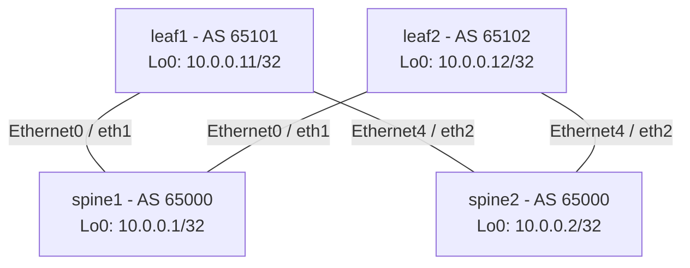

# 2-Spine, 2-Leaf Data Center CLOS Fabric on SONiC

## Project Overview
Designed, deployed, and verified a virtualized **Layer-3 Spine-Leaf (CLOS) data center fabric** using **SONiC (Software for Open Networking in the Cloud)** and **Containerlab**. Implemented **eBGP Unnumbered** (RFC 5549 / RFC 7938) with IPv6 Link-Local neighbor discovery and **Equal-Cost Multi-Path (ECMP)** routing for active-active East-West traffic forwarding.

## Architecture Diagram


## Key Technologies & Features
* **Network OS:** Community SONiC (`docker-sonic-vs`)
* **Orchestration:** Containerlab (Infrastructure-as-Code YAML topology)
* **Routing Protocol:** eBGP Unnumbered over IPv6 Link-Local interfaces via FRRouting (`vtysh`)
* **Load Balancing & HA:** BGP ECMP (`multipath-relax`) across dual spines with active-active FIB installation

## Engineering Challenges Solved
* **RFC 8212 Policy Enforcement:** Diagnosed `(Policy)` BGP state on FRRouting 8+ and configured `no bgp ebgp-requires-policy` with soft route-refresh (`clear ip bgp * soft`) to enable prefix exchange across external ASNs.
* **Containerized Control Plane Management:** Managed SONiC's internal microservices (`bgpd`, `zebra`, `intfmgrd`, `orchagent`) via `supervisorctl` and validated declarative state persistence in `/etc/sonic/config_db.json`.

## Repository Structure
* `clos.clab.yml` — Containerlab topology definition
* `configs/` — Exported SONiC `config_db.json` and FRR BGP configurations
* `verification/` — Live CLI outputs (`show ip bgp summary`, `show ip route`, and ECMP ping tests)

## How to Reproduce
```bash
sudo containerlab deploy -t clos.clab.yml
```
